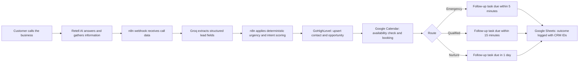

# RoofFlow Voice AI: Architecture

Inbound AI voice receptionist and lead qualification automation for roofing businesses. Demo built with sample data.

**Inbound Call → Understand → Prioritize → Record → Book → Follow Up**

## Components
| Component | Role |
|---|---|
| Retell AI | Inbound voice AI that answers calls and gathers information |
| n8n | Webhook, orchestration, and urgency scoring |
| Groq | Structured information extraction |
| GoHighLevel | CRM, pipeline, and follow-up tasks |
| Google Calendar | Availability and booking |
| Google Sheets | Audit log |
| Webhooks | Communication between services |

## Follow-up Routing
| Lead type | Follow-up task |
|---|---|
| Emergency | Due within 5 minutes |
| Qualified | Due within 15 minutes |
| Nurture | Due in 1 day |

## Reliability
Fixed extraction schema · Deterministic urgency rules · Contact upsert to reduce duplicates · Explicit routing branches · Every routed outcome logged to Google Sheets

## Not published
Real customer data, phone numbers, emails, client or company names, credentials, live webhook URLs, account or workspace IDs, call transcripts, and workflow exports.
