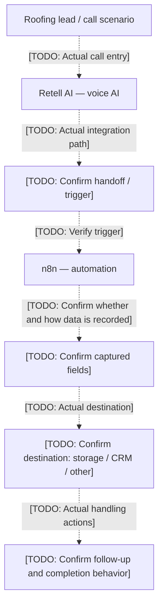

# RoofFlow — Architecture (verification pending)

**Confirmed:** RoofFlow concerns AI voice and lead automation for roofing leads. It uses **Retell AI (voice AI)** and **n8n**. The business problem is missed calls and slow follow-ups.

**Not confirmed:** the actual inbound call provider, trigger sequence, Retell-to-n8n integration, information captured, storage/CRM, follow-up actions, or delivery/handling rules. The diagram below is a **documentation scaffold**, not a verified production architecture. **Dotted connectors are unknown transitions**, not confirmed integrations.

## Details to verify before replacing TODOs

| Question | Current status |
| --- | --- |
| How does a call reach the voice-AI system? | [TODO: Confirm actual entry point and trigger.] |
| What happens during the call? | [TODO: Confirm real conversation steps and any conditions.] |
| How does n8n participate? | [TODO: Confirm actual event, trigger, or data transfer.] |
| What information is captured? | [TODO: List verified field names only.] |
| Where is it stored? | [TODO: Confirm actual destination; Google Sheets or a CRM is **not** established.] |
| What happens after the call? | [TODO: Confirm the actual follow-up mechanism.] |
| What may be publicly shared? | [TODO: Get approval for any further details or diagrams.] |

## Privacy / sanitization

Do not publish real customer information, phone numbers, email addresses, client or company names, credentials, live webhook URLs, workspace/account IDs, recordings, raw transcripts, or identifying screenshots. If a real n8n export is provided later, sanitize and review it before committing anything to `workflows/`.
