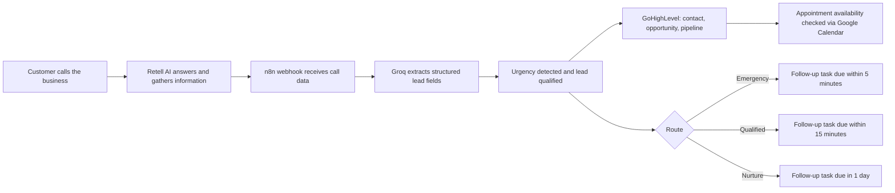

# RoofFlow Architecture

RoofFlow is an inbound AI voice receptionist and lead qualification automation for roofing businesses. A customer calls, the voice AI answers and gathers information, and n8n turns the conversation into a structured, prioritized CRM record with the right follow-up.

## Flow

**Inbound Call → AI Assistance → Data Extraction → Lead Qualification → CRM → Appointment Booking**

## Components

| Component | Role |
|---|---|
| Retell AI | Answers inbound calls and holds the conversation |
| n8n | Receives webhook data and orchestrates the workflow |
| Groq | Extracts structured lead information with a predefined prompt |
| GoHighLevel | CRM: contacts, opportunities, pipeline, and follow-up tasks |
| Google Calendar | Appointment scheduling and availability |
| Webhooks | Communication between services |

## Follow-up routing

| Lead type | Follow-up |
|---|---|
| Emergency | Task due within 5 minutes |
| Qualified | Task due within 15 minutes |
| Nurture | Task due in one day |

## Design decisions
- A predefined extraction prompt so lead data comes out in a consistent structure
- Contact upsert logic to reduce duplicate records
- Explicit routing branches by urgency

## Not included in this repository
Real customer data, phone numbers, emails, client names, credentials, live webhook URLs, account IDs, call transcripts, and workflow exports.
